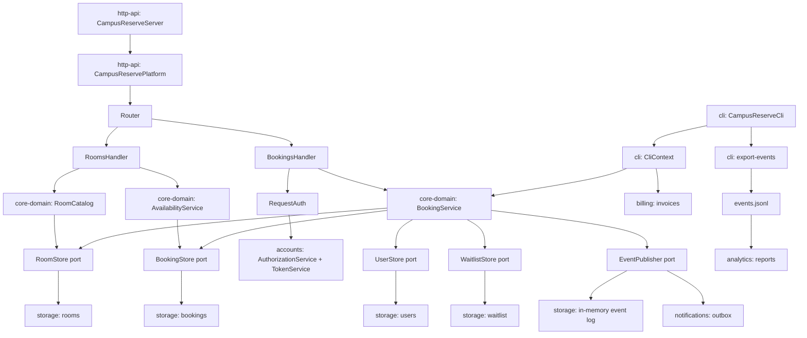

# BOUNDARIES.md

## Milestone 1: The architecture as built

**The sketch.** Arrows are runtime calls or data writes; store labels name the data written.

Availability path: `CampusReserveServer -> CampusReservePlatform -> Router -> RoomsHandler.availability -> RoomCatalog + AvailabilityService -> RoomStore + BookingStore -> storage`.

Booking path: `CampusReserveServer -> CampusReservePlatform -> Router -> BookingsHandler.create -> RequestAuth -> AuthorizationService/TokenService -> BookingService.requestBooking -> BookingStore/RoomStore/UserStore/WaitlistStore -> EventLogPublisher -> in-memory event log and NotificationService`.

**Where my sketch and `ARCHITECTURE.md` disagree, and how I checked.**

1. The document calls the CLI entry `BookCommand`; source has `BookingCommands.Book`. `rg -n "BookCommand|BookingCommands" .` finds the stale diagram label, `BookingCommands.java`, and registrations in `CampusReserveCli.java` lines 112--115; no `BookCommand` class exists.
2. The document includes the durable `JsonlFileEventLogWriter` path; the shipped HTTP runtime sketch ends in `InMemoryEventLog`. `CampusReservePlatform` line 44 calls `StoreRegistry.inMemory()`, which constructs `InMemoryEventLog` at `StoreRegistry` line 33. `rg -n "withEventLogFile|JsonlFileEventLogWriter"` finds only the alternate implementation and tests, not an HTTP-platform caller.

## Milestone 2: Run it as copies

Pending implementation of the Compose stack and k6 checks.

## Milestone 3: One boundary

Pending selection after the copy checks.
