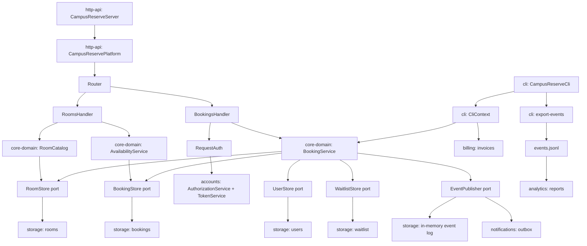

# BOUNDARIES.md

## Milestone 1: The architecture as built

**The sketch.** Arrows are runtime calls or data writes; store labels name the data written.

Availability path: `CampusReserveServer -> CampusReservePlatform -> Router -> RoomsHandler.availability -> RoomCatalog + AvailabilityService -> RoomStore + BookingStore -> storage`.

Booking path: `CampusReserveServer -> CampusReservePlatform -> Router -> BookingsHandler.create -> RequestAuth -> AuthorizationService/TokenService -> BookingService.requestBooking -> BookingStore/RoomStore/UserStore/WaitlistStore -> EventLogPublisher -> in-memory event log and NotificationService`.

**Where my sketch and `ARCHITECTURE.md` disagree, and how I checked.**

1. The document calls the CLI entry `BookCommand`; source has `BookingCommands.Book`. `rg -n "BookCommand|BookingCommands" .` finds the stale diagram label, `BookingCommands.java`, and registrations in `CampusReserveCli.java` lines 112--115; no `BookCommand` class exists.
2. The document includes the durable `JsonlFileEventLogWriter` path; the shipped HTTP runtime sketch ends in `InMemoryEventLog`. `CampusReservePlatform` line 44 calls `StoreRegistry.inMemory()`, which constructs `InMemoryEventLog` at `StoreRegistry` line 33. `rg -n "withEventLogFile|JsonlFileEventLogWriter"` finds only the alternate implementation and tests, not an HTTP-platform caller.

## Milestone 2: Run it as copies

**Your stack.** `docker compose up -d --build --scale api=2`, then wait six seconds because nginx refreshes Docker DNS every five seconds. `compose.yaml` has exactly `api`, `proxy`, and `k6`; use `docker compose run --rm --no-deps` so running k6 cannot start a one-copy dependency set.

### Finding 1: tokens

**The claim.** A token minted by either API copy works on every request through the proxy, whichever copy answers it.

**The script and its result.** `load/tokens-any-copy.js` sends 20 non-reused proxy connections with one `u-1` token. Its `token_works_on_every_copy: rate==1` threshold requires every response to be 200, and the script logs each `X-Upstream` address. The script is run with `docker compose run --rm --no-deps -e TOKEN='one u-1 token' k6 run /scripts/tokens-any-copy.js`. A two-copy run is expected to show two upstream addresses and 200s from the minting copy plus 401s from the other; therefore the threshold fails.

**Why, from the code.** `TokenService` owns `LinkedHashMap<String, Token> byValue` (line 30). Every `CampusReservePlatform` constructs a fresh `AccountDirectory`, `TokenService`, and `AuthorizationService` (lines 52--54). `RequestAuth.require` authenticates through this process-local map; no token state is shared.

**The kind of problem.** Split-brain session state: a stateful service behind a load balancer with no shared session owner.

### Finding 2: bookings

**The claim.** For a given room and time interval, at most one confirmed booking exists across the platform.

**The script and its result.** `load/booking-at-most-once.js` concurrently posts the same future one-hour request directly to each API container, using each container's own `u-1` token. It bypasses the proxy because the token failure would obscure the booking result. Its thresholds, `room_slot_booked_at_most_once: rate==1` and `duplicate_confirmations: count==0`, fail when both copies return 201.

**Why, from the code.** `CampusReservePlatform` calls `StoreRegistry.inMemory()` (line 44), which creates distinct `InMemoryBookingStore`, room, user, and waitlist stores (`StoreRegistry` lines 23--26). `BookingService.requestBooking` reads `bookings.findActiveByRoom` and then saves. Each copy therefore reads its own empty calendar and confirms independently.

**The kind of problem.** Split-brain authoritative data: the global uniqueness invariant is not enforced at the data owner.

### What I checked

The agent proposed the event log as possible shared state. I checked the actual HTTP wiring: it uses the in-memory log, and even the JSONL writer is an append-only event sink, not a booking read model or transaction coordinator. It fixes neither token lookup nor the booking race.

## Milestone 3: One boundary

Pending selection after the copy checks.
